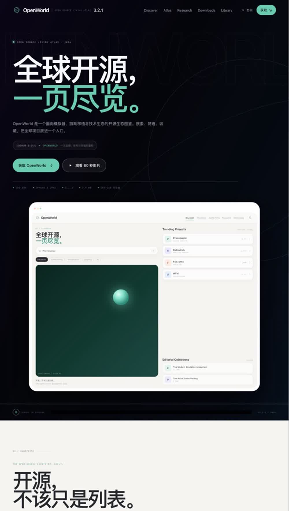
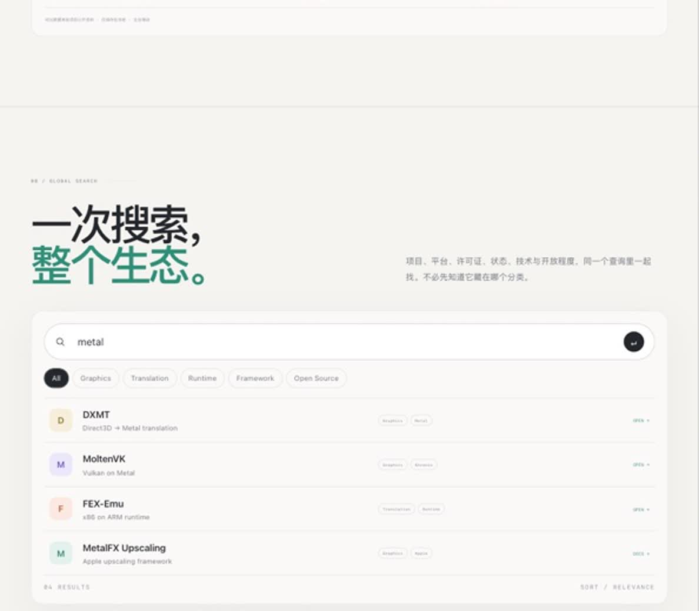
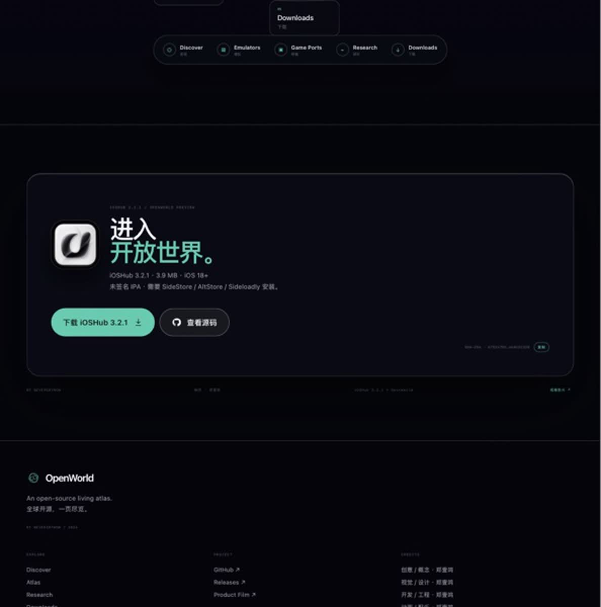

# OpenWorld — Product Site

A single-page product site for **OpenWorld**, the open-source living atlas for emulators, game ports, technical research, and verifiable downloads.

Built from the existing OpenWorld 60-second product film and stills in `../openworld-film`. No framework, no build step — plain HTML, CSS, and JavaScript, ready for GitHub Pages.







## What is here

- **Hero + live app preview** — a glass tablet rendering the Discover / Emulators / Game Ports / Research / Downloads screens. Tabs are interactive and gently auto-cycle until you take over.
- **Discover** — search and category filtering across six projects; every card opens a project detail dialog with overview, compatibility, resources, changelog, source link, and a local favorite state.
- **Atlas** — Emulators / Game Ports switch, platform filters, compatibility meters, and the original-files notice.
- **Research** — an interactive technology graph. Select a node to update the detail rail; related nodes are clickable.
- **Downloads** — a working progress manager demo with pause / resume / retry / SHA-256 states, plus Wi-Fi, concurrency, and auto-verify settings. It is explicitly labeled as a demo and does not download files.
- **Media intelligence** — six source categories (Official / Community / Video / Developer / Technical / Product Film), a lightbox, and stills from the new v3 product film.
- **Library** — local-first favorites, collections, and a compare table for up to three projects.
- **Global search** — a live query across projects, technologies, tags, and source types, with facet filters.
- **Five entrances** — the radial map and native-style dock link the five product areas.
- **Real build** — the current iOSHub 3.2.1 unsigned IPA (3.99 MB, SHA-256 `675247dce3d4213b3321ff171df664c5c49c98e7ca91d51bfe6814f46ac2c32b`) is included at `assets/downloads/iOSHub-3.2.1-unsigned.ipa`, with the app’s real icon and grain texture. It requires SideStore / AltStore / Sideloadly; it is not an App Store build.
- **Film** — `assets/film.mp4` is the new 60-second OpenWorld v3 product film, compressed to 5.5 MB for the web and loaded only when opened. V3 has burned-in Chinese captions, so no external subtitle track is needed.
- **Download integrity** — `assets/downloads/SHA256.txt` contains the checksum shown on the download card.

## Run locally

```sh
cd openworld-site
python3 -m http.server 4174
# open http://127.0.0.1:4174
```

No install or build required.

## Deploy on GitHub Pages

完整逐步教程见 [`GITHUB-DEPLOY.md`](GITHUB-DEPLOY.md)。

1. Create a new repository, for example `openworld-site`.
2. Push this directory to `main`.
3. In GitHub: **Settings → Pages → Build and deployment → Source: GitHub Actions**.
4. The included workflow (`.github/workflows/deploy.yml`) uploads the site and deploys it on every push to `main`.

If you use a custom domain, add a `CNAME` file. If you rename the repository, update the paths only if you move assets; all paths are relative.

## Links to update

The site currently points to the known public source hub:

- Source / Releases: `https://github.com/NevercRyNow/openworld`
- Film / stills: `../openworld-film/out/` (not deployed as source)

If the production app lives at a different repository or download URL, update:

- the `获取 OpenWorld` / `查看源码` links in `index.html`
- the `PROJECTS[*].url` values in `app.js`
- `og:image` / canonical metadata in `index.html` once a domain exists

## Content and credits

- Concept, design, film, and original OpenWorld assets: **郑壹鸣 / NEVERCRYNOW**.
- `iOSHub-3.2.1-unsigned.ipa` was supplied for this site; the app icon and grain texture are extracted from that build.
- Product film and stills are reused from the existing `openworld-film` project; the film is credited in the site footer and film dialog.
- Project names and links belong to their respective open-source projects.
- The download manager and compatibility numbers are interface demonstrations based on the product film, not live release telemetry. The real IPA button downloads the supplied unsigned build directly.
- No third-party fonts or icon libraries are used. Typography is the system SF / PingFang stack.

## License

Site code is MIT — see `LICENSE`. The OpenWorld name, brand, film, and stills remain the property of their respective owner.
